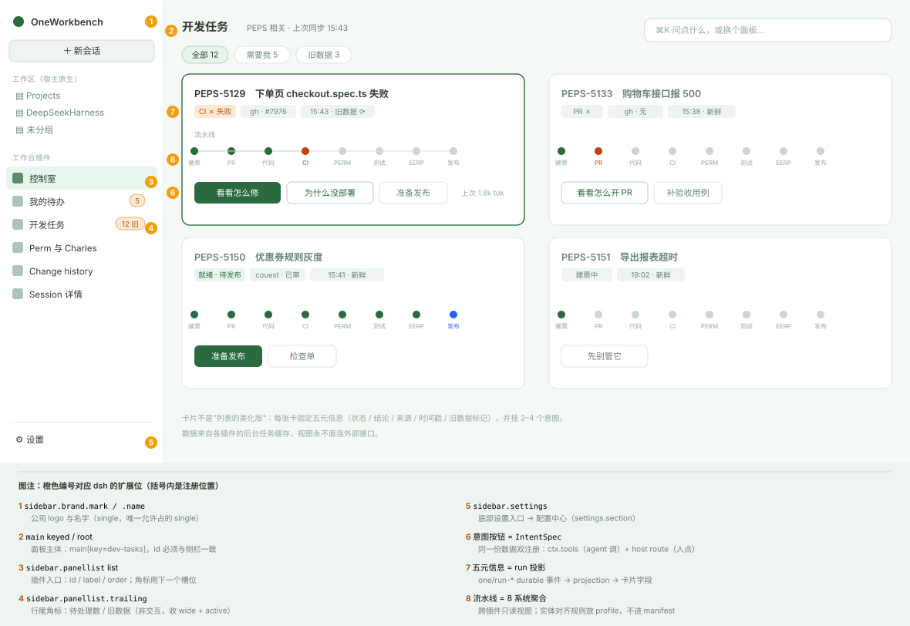
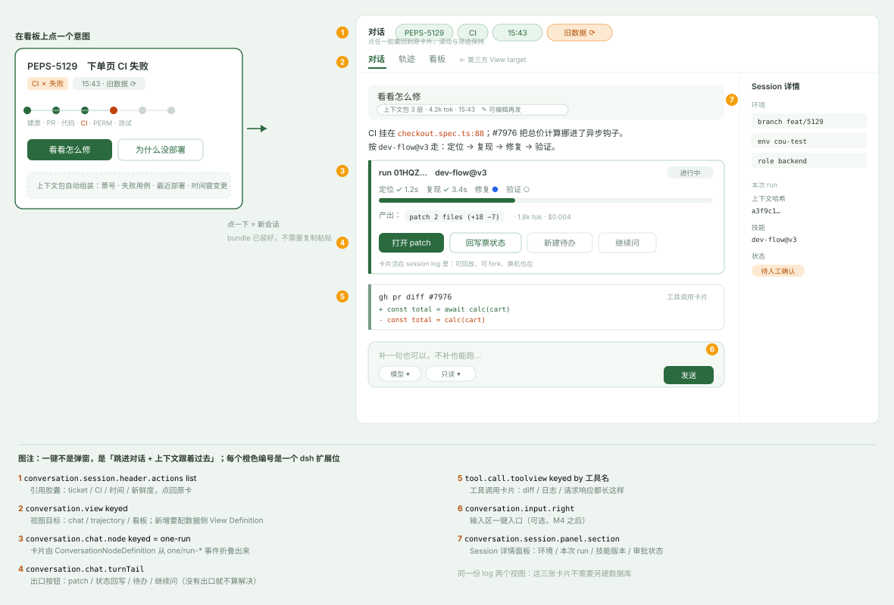
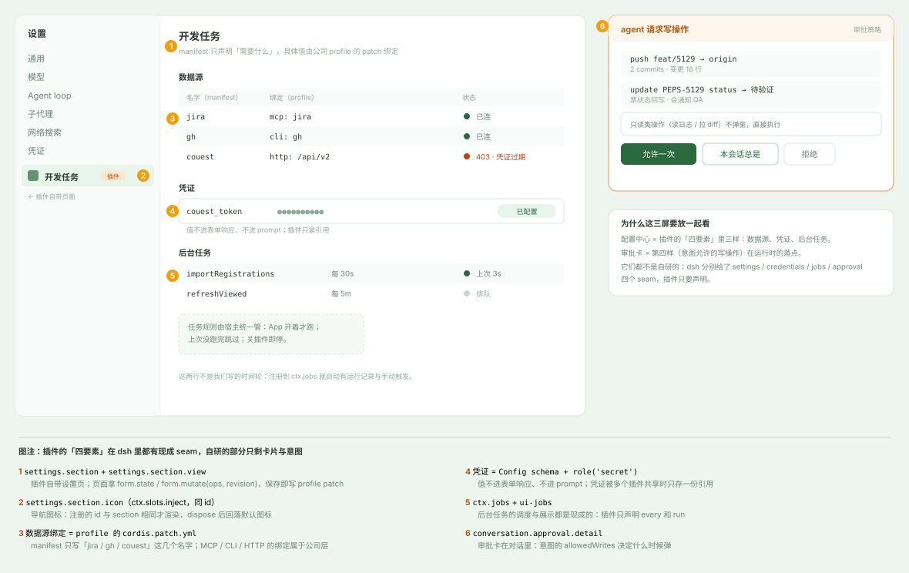

## goal
- OneWorkbench = **桌面总入口 + 一键 AI**。
- 核心不是看板，而是：**卡片上的一次点击，变成一段上下文齐备、按 skill 执行、且留下记录的对话**。

## 核心：一键 AI

```
看到异常（卡片 / 行 / 曲线点）
  → 点意图（看看怎么修 / 为什么没部署 / 准备发布）
  → 跳到对话（新建会话，上下文已装好，skill 已挂上）
  → 产出 patch / 结论 / 状态回写，并落一条 run 记录
```

### 上下文包三层

| 层 | 内容 | 来源 |
| --- | --- | --- |
| 实体 | 票号、PR、分支、环境、role、时间点 | 视图当前实体 |
| 现场 | 失败用例 + 报错片段、最近部署、时间窗变更、日志尾部 | 数据源（插件缓存） |
| 意图 | 动词 + 期望输出 + 绑定的 skill | 意图模板（插件资产） |

**必须把新鲜度传进去**（卡片上的「15:43 · 旧数据」），否则模型拿旧数据下结论。

### 四条规则

1. 一键不是零输入：可以补一句，不补也能跑。
2. 上下文由系统打包，用户不复制粘贴。
3. 结果必须有出口：patch / 状态回写 / 新建待办。
4. 意图模板 + skill 是资产，可版本化。

## 交互：一键 = 跳进对话

- **形态定案：跳转到对话页**（不弹窗、不抽屉）。对话才是活儿发生的地方，且能留历史。
- 顶部一排「引用胶囊」：`PEPS-5129` `CI` `15:43` `旧数据 ⟳`，点任一回到原卡片。
- 默认新建会话，避免串上下文；只有同票同视图才允许并进当前会话。
- 回到原视图时保留滚动与筛选；卡片状态若已变则刷新。

一次点击的时序：捕获视图快照 → 组装 bundle → 选会话 → 首条消息 = 意图模板 + bundle（可编辑再发）→ 落 run 记录。

## 执行链：意图 → skill → 记录

- 意图上挂 skill（我用的 `dev-flow`）：一键后按 skill 的步骤走（定位 → 复现 → 修复 → 验证），不是让模型自由发挥。
- 全程和「功能」挂钩，**产生 db 记录**：`run_id, feature_id, intent, skill+version, session_id, context_hash, steps[], output, status, cost, ts`。
- 收益：可追溯（三个月后能查这张票问过什么）、可统计（哪个意图最常用 / 哪一步常卡）、可复用（第二次一键直接带上上次记录）。

## UI：桌面总入口

- 形态对标 DeepSeek Desktop：顶部常驻输入（⌘K）+ 左侧插件与会话历史 + 中间看板。
- 差别：**面板是主体，对话是"跳过去"的另一个页面**，不是叠加层。
- 左侧栏每一项都是插件；关掉插件，入口和后台任务一起消失。

## 插件模型

插件声明：**侧栏入口 · 后台任务 · 凭证 · 卡片/意图**。

| 插件 | 侧栏 | 后台任务 | 动作 |
| --- | --- | --- | --- |
| Copilot | Devin | collectTasks 15s | 18 |
| 我的待办 | 常用 | jiraDailyScan 1m | 5 |
| 开发任务 | 开发测试 | importRegistrations 30s / refreshViewed 5m | 4 |
| Perm 与 Charles | 开发测试 | refreshPerms 1m | 5 |
| Change history | 可靠性 | syncAbc / syncDeploys 1h | 13 |
| Session 详情 | 调试 | — | 4 |
| 配置中心 | 设置 | — | 3 |

意图 = UI 按钮 + agent 能力的同一份数据。

## 票：8 个系统拼成一条流水线

建票(jira) → PR(gh) → 代码(gh) → CI(gh pr checks) → PERM(CouTest) → 测试(Charles+QA) → EERP → 发布(Couest)。

每张卡五元信息：状态 · 结论 · 来源 · 时间戳 · 旧数据标记，再加意图按钮。难点是实体对齐，规则公司特有、必须可配置。

## 技术选型

- **TS**：manifest → UI → 调度 → MCP → agent SDK 全栈同语言，类型共享；重计算交 Python CLI。
- **Electron**：需要本机凭据、文件系统、常驻快捷键；主进程即 Node，能直接加载 agent SDK。
- **agent 后端 = 接口 + 两实现**：
  - `piSdkBackend`（首选）：`createAgentSession()`，跑在 main 或 utilityProcess。注意 SDK 不自动加载内置扩展（MCP/codemode/tool_search 显式注册 + `bindExtensions()`），`agentDir` 做隔离。
  - `acpBackend`：接 Devin 这类外部 agent。
  - `piRpcBackend`：子进程 JSONL，仅作隔离降级项。
  - 内核备选：`dsh`（DeepSeek Harness），插件下沉到内核层，见下一节。
- **数据**：MCP 优先，没有就包 CLI / 薄 HTTP。

## 备选内核：dsh（DeepSeek Harness）

> `pi` 不是唯一选项。`deepseek-ai/deepseek-harness`（`dsh`，MIT / TypeScript，2026-08 开源）把「插件」下沉到了内核层：口号是「万物皆插件」，底座是 Cordis，模型适配器、工具注册表、session log、**连 agent loop 本身**都是插件。没有特权内核——扩展方式是「在旁边装一个插件」，不是「打补丁」。

### 差别不在扩展点数量，而在「加」还是「换」

| 维度 | pi coding agent | dsh |
| --- | --- | --- |
| 扩展语义 | 固定内核 + 加法注册表：往 loop / log / 工具流水线 / TUI 上挂东西 | 无特权内核的插件树：核心那几块自己也是插件 |
| 抽象单位 | hook / registration | **seam 三角**：Service Definition + Provider + Consumer，加一个能力要设计三样 |
| 组合与分层 | settings 合并（项目覆盖 agent 目录）+ `agentDir` 换目录做隔离 | `profile → bundle → cordis.patch.yml → --patch` 有序图层，按 row id 整行替换；`--dump-config` 打出来的任何一行都能 patch |
| 隔离粒度 | 目录级 | profile 级 + **per-session**（agent preset + `isolate` realm） |
| 撤销语义 | `pi.on()` 可退订，但**工具不可注销**（只能用 `exposure: "hidden"` 撤回） | 注册即 effect，插件卸载自动回卷 |
| UI 归属 | `ctx.ui` 只能长在 pi 的 TUI 布局里；要换壳就走 RPC、自己拥有全部 UI | UI 也是插件：slot 注册、新开 View target、占 shell overlay seat |
| 记录 / 真源 | JSONL 会话树（有版本迁移），存储只有 `sessionDir` | durable session log 是唯一真源（「model-visible means logged」），持久化与投影都可替换 |

### 四层可扩展性

| 层 | 扩展什么 | pi | dsh |
| --- | --- | --- | --- |
| L0 加能力 | tool / command / UI 挂件 / MCP / provider | ✅（工具暴露设计更细：exposure 五档 + `prepareLoadout`） | ✅ |
| L1 换实现 | 存储、fs、shell、sandbox、PTY、LSP、subagent | ❌ 这几块不在扩展点表上 | ✅ 换一个 provider 就换掉整条链 |
| L2 换骨架 | agent loop、prompt 组装、session 格式、进程 / UI 形态 | ⚠️ 只能走 RPC 重写 UI，等于退出扩展机制 | ✅ 官方自己就用一套插件树产出 `web` / `headless` / `sdk` / `sdk-minimal` / `acp` + Electron 桌面 |
| L3 长生态 | 分发 / 市场 / 能力包 / 按 profile 售卖 | packages（npm / git） | bundle 分发格式 + 插件市场 + `dsh.profile` / `dsh.bundle` |

**L2 是分水岭**，而 dsh 在 L2 的证据是它自己 dogfood 出来的：一个内核 → 五种 profile → Web / 桌面 / TUI / 手机 / ACP 接入外部 agent。

### UI 也是插件（扩展单位是槽位和视图，不是控件）

| 层 | 机制 | 能干什么 |
| --- | --- | --- |
| 槽位 | `ctx.slots.register({ name: 'sidebar.right', inject }, Component)` + 父级 `renderSlot(...)` | 往 `sidebar.*`、`tool.call.toolview`、`settings.section`、`plugins.detail.*` 塞组件；父组件用 `children` 声明子槽，插件能注进**别人的页面** |
| 页面 | `package.json` 里 `dsh: { client: {...} }` + 导出 `./client`，由 client module system 按需下发 | 整页（看板 / 工作台 / 编辑器）就是一个插件；它的半身绑在 Loader row 上，**row 关掉，页面和它注册的 slot 一起消失** |
| 视图目标 | `ConversationNodeDefinition` + 自定义 `View Definition` | 不是改控件，是在 Chat / Trajectory 旁边**新开一种呈现方式** |
| 配置界面 | `Config` schema + `Volatile`；自定义页拿 `form.state` / `form.mutate` | 改配置 = 写 profile patch，下次启动还原；凭证走 `role('secret')` |

代价是约定强：新增一种卡片，得先定义**可回放的 durable 事件族**（稳定 `(kind, id)`，按 `seq` 重放能确定性重建），再做 `SessionEventMap` declaration merge，然后写 Node Definition 和 renderer。好处是这张卡片活在 session log 里——可回放、可 fork、可迁移。

### 映射到 OneWorkbench

| 本方案的机制 | dsh 里长在哪 |
| --- | --- |
| 一键的上下文包（实体 / 现场 / 意图 + 新鲜度） | `agent.inject()` 落进下一个被接纳的 request；`agent/pre-step` 可改可拒 |
| 跳进对话 + 引用胶囊 | 注册 `ConversationNodeDefinition` + 自定义 renderer，从 `session/event` 渲染 |
| run 记录（`run_id / feature_id / intent / skill+version / steps / cost`） | 定义 `run/start` `run/step` `run/end` 三个 durable 事件 → 记录本身就是会话历史；要落公司库就实现 `SessionPersistence` 或注册 projection |
| 卡片 = 一条记录 + 五个元信息 | 一个 Node Definition 把 run 事件折叠成「票卡片」；状态 / 结论 / 来源 / 时间戳 / 旧数据标记都是事件字段 |
| 看板 | 一个第三方 **View target**，与 Chat 并列，从同一份 session log 渲染成网格 |
| 插件 manifest（侧栏 / 后台任务 / 凭证 / 意图） | profile + bundle（`dsh.profile` / `dsh.bundle`）+ `ctx.jobs` + settings card + `ctx.commands` |
| 意图按钮人点、agent 也能自己调 | `ctx.commands`（不经模型的指令）与 `ctx.tools`（模型侧）是同一份能力 |
| 换一家公司 | 一个 profile + 一层 patch；`dsh --profile <name> --dump-config` 能看到整棵树 |
| 审批 / 回写权限 | `ctx.sandbox` + approval policy seam |

一句话：**在 dsh 里「看板」和「对话」不是两个系统，是同一份 durable log 的两个视图。** 这比「appendEntry 塞 JSONL + 另建 db + 自己渲染」结构上干净。

### 界面原型（橙色编号 = 动手时要注册的槽位）

三张图不是「更好看的线框」：图注就是注册清单，编号点在界面上哪个位置，那个位置就是要挂的 slot。



**图 6 主窗口**：侧栏是 `sidebar.panellist`，行尾角标是 `sidebar.panellist.trailing`，面板主体是 `main[key=dev-tasks]`；卡片五元信息来自 run 投影，意图按钮是 `IntentSpec` 的双注册；8 阶段流水线是跨插件只读视图，实体对齐规则在 profile 而不在 manifest。



**图 7 一键后的对话**：顶部引用胶囊是 `conversation.session.header.actions`；视图页签是 `conversation.view`（对话 / 轨迹 / 看板）；带阶段进度的 run 卡片是 `conversation.chat.node` 里新增的 `one-run` key；出口按钮那一行是 `conversation.chat.turnTail`；工具调用卡片是 `tool.call.toolview`；右侧详情是 `conversation.session.panel.section`。



**图 8 配置与审批**：插件自带页是 `settings.section`（图标要 `settings.section.icon` 同 id 注入）；数据源绑定属于 profile 的 `cordis.patch.yml`，**不进 manifest**；凭证走 `Config` schema + `role('secret')`；后台任务注册到 `ctx.jobs` 就自带运行记录与展示；写操作审批卡是 `conversation.approval.detail`。

> 三张图的源文件：`assets/mock-1-workbench.svg` / `mock-2-run-to-chat.svg` / `mock-3-config-approval.svg`（手写矢量，可直接导入 draw.io 或 Figma 编辑）。

### 现成例子（都已在跑）

| 项目 | 是什么 | 值得抄的点 |
| --- | --- | --- |
| `Aisland-SJL/dsh-worktable` | 侧栏 app drawer + 可停靠分屏工作区 + 控制室卡片网格 | 控制室是**纯事件镜像**（读宿主 session 快照，不走模型）；分屏引擎自建后塞进 shell overlay seat；能把 `dsh-travelatlas` 当 pane 嵌进来 |
| `ScarecrowFu/dsh-laofu-workbench` | 「工作台内核 + 场景能力包」的可动态装卸工作台，公开包 + 私有会员包 | **和我们同构**：拆成内核（DSH Profile / 浏览器壳 / 包 SDK / 桌面打包 / 上游升级）+ 业务包；用 `UPSTREAM.lock.json` 锁上游版本 |
| `AKS1st/dock` | VSCode 式 workbench shell，暴露 `ctx.workbench` 供别人挂 panel / view / command | 插件 manifest 的社区级抽象 |
| `virgoC0der/dsh-plugins` / `JianwuYang/dsh-ui-kanban` | PR + Jira + Calendar + 本地 git 的工作看板；Jira / GitLab 变成 agent 可操作的看板 | 我们的「票流水线」已经有人拆着做 |
| `anywhere-labs/dsh-desktop` / `dsh-Go` / `dsh-TUI` | 桌面壳 / 手机端 / 终端 | 证明换壳不用动内核 |

### 三条边界（「无限扩展」的尽头）

1. **接口有一半是别人定的**：挂在已有 seam 上就被那个 interface 约束；想加内核不认识的能力，得自己开 seam（定义 + 实现 + 消费三件全写）。
2. **模型侧是硬瓶颈，这层 pi 更强**：插件再多，到模型面前只有 tool schema + prompt 预算；`exposure` 五档、`prepareLoadout`、`reachesTools`、codemode / tool_search 这些抗工具过载的设计 pi 做得更细。
3. **换壳仍有尽头**：overlay seat 能塞自建引擎，但原生窗口 / 系统级集成最终会变成 fork 上游（laofu 就是 fork + 私有快照），到那一步又回到「自己拥有整个应用」。

风险面：dsh 是 **developer preview**，README 明写会有 breaking changes，社区插件普遍钉死具体 rc 版本。所以「扩展性上限」和「钉版本成本」是同一枚硬币。

### 判据：改的是「内容」还是「结构」

- **内容层**（加数据源、加意图模板、加卡片）→ pi 足够，且更稳（稳定版，契约写得细）。
- **结构层**（多公司 profile、能力包热装卸、换存储 / 沙箱 / loop、少写 UI）→ dsh 的结构天生对着这个。
- 需要「run 记录落公司库 + 看板 + 对话同源」→ 这条把天平推向 dsh。

下一步不是选型投票，而是**同需求 A/B**：拿「一张 PEPS-5129 卡片 + 一个意图 + 一条 run 记录」在两个内核上各写一遍，记三件事——上手时间、代码行数、要绕的地方。

## 换一家公司

底座不动。换：数据源、插件集、意图模板 + skill、凭证、agent 规范。

## 落地

1. 一个插件 + 一张卡 + 一个意图（含 skill 与记录），硬编码跑通。
2. 抽 manifest，做第二个插件。
3. 跳转对话 + 引用胶囊 + 出口按钮。
4. 配置中心。
5. 第二个公司 profile。

## 未决

1. 新会话 vs 并入当前会话的判定规则。
2. 意图模板格式（纯 prompt / 结构化 steps / 混合）与 skill 的边界。
3. 记录粒度：一次一键一条，还是每步一条。
4. 回写权限：agent 能否直接改票、开 PR、触发发布。
5. 后台任务：App 内定时器 vs 外部 cron。
6. 内核选型：pi SDK（稳）vs dsh（结构上限高）——等同需求 A/B 的结果。

## 附：这套东西是怎么建起来的
- 造这个平台用的手法见 `docs/use-llm/vibe-coding.md`（六步骨架：mockup → DB → 流程图 → 命名 → 目录 → 分层）。
